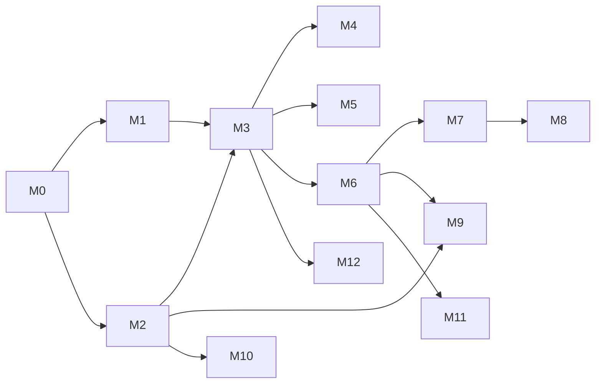

# Module map (implementation order)

Implement in this order. Each module has its own file under `modules/`.

```text
M0  Supabase foundation
M1  Account / Auth
M2  Subscriptions / entitlements
M3  Family + memberships + switcher
M4  Account Access Tokens (Account Owner only)
M5  Email invitations (family-scoped)
M6  Members (profiles, placeholders, codes)
M7  Relationships (integrity)
M8  Family Tree UI (Lineage-style)
M9  Image selection (preview + limits only)
M10 Razorpay Edge Functions
M11 Events / timeline / dashboard
M12 Family settings
M13 Memories (parity with old app, no image binaries)
M14 Design system (white light + dark)
```

## Complete flow (Account → Family)

```text
Register Account
      ↓
Account Owner (billing + tokens live here)
      ↓
Select / create subscription (Free default)
      ↓
Create Family  →  membership role = Owner
      ↓
Family Workspace (switcher if multi-family)
      ↓
Add any member (no mandatory self)
      ↓
Add parents / children / partners / connect existing
      ↓
Collaborate:
  A) Email invite → family role
  B) Public Access Token → Account Owner managed
```

## Dependency graph



## Isolation

All code for these modules lives in `midnight-web` only. Do not edit `Midnight-Tree` or `Midnight-Api`.
